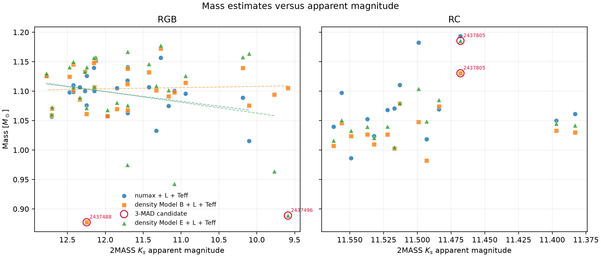
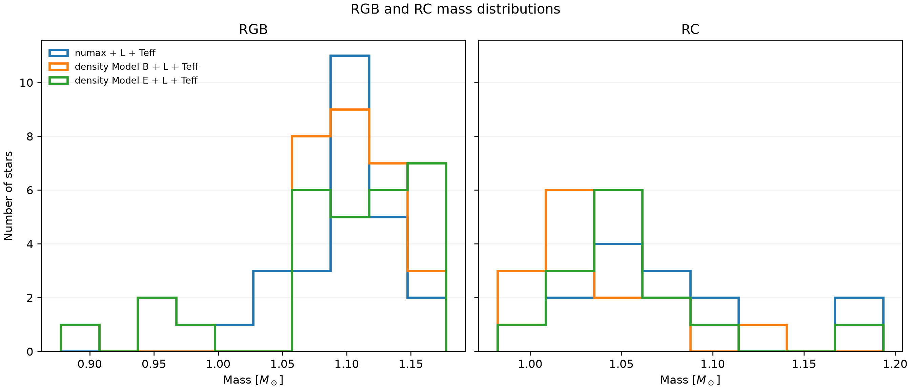

# Mass inference for NGC 6791 RGB and RC stars

## Method

The analysis uses the fixed-distance-modulus luminosity catalogues and requires
exact agreement in both KIC and Gaia DR3 ID for every external match. Catalogue
RGB/RC membership is preserved even when the Yu et al. phase flag differs.

The radius implied by luminosity and temperature is

$$
\frac{R}{R_\odot} = \left(\frac{L}{L_\odot}\right)^{1/2}
\left(\frac{T_{\rm eff}}{T_{{\rm eff},\odot}}\right)^{-2}.
$$

The two mass combinations are

$$
\frac{M_{\nu_{\max}}}{M_\odot} =
\frac{\nu_{\max}}{\nu_{\max,\odot}}
\frac{L}{L_\odot}
\left(\frac{T_{\rm eff}}{T_{{\rm eff},\odot}}\right)^{-7/2}
$$

and

$$
\frac{M_\rho}{M_\odot} =
\frac{\bar\rho}{\bar\rho_\odot}
\left(\frac{L}{L_\odot}\right)^{3/2}
\left(\frac{T_{\rm eff}}{T_{{\rm eff},\odot}}\right)^{-6}.
$$

The adopted constants are $T_{{\rm eff},\odot}=5772$ K and
$\nu_{{\max},\odot}=3090$ $\mu$Hz. The detailed-modelling
quantity is interpreted as
$\bar\rho/\bar\rho_\odot=\mathtt{M\_R3\_ppm}/10^6$. Model B and Model E
remain separate throughout.

## Shared distance and the effect of its uncertainty

Yes: every RGB and RC luminosity in these fixed-modulus catalogues uses the same
cluster distance, $4122.9$ ± $163.9$ pc. This comes from
the adopted apparent V-band modulus $13.51$ ±
$0.06$ mag together with the fixed reddening. The distance
uncertainty is therefore a common systematic, not an independent error for each
star.

Because $L\propto d^2$, the two mass estimates scale as
$M_{\nu_{\max}}\propto d^2$ and $M_\rho\propto d^3$. The shifts required to move
the current RGB arithmetic mean to 1.15 $M_\odot$ are:

| Method | Current_RGB_mean_Msun | Distance_modulus_shift_to_target_mag | Distance_shift_to_target_pc | Distance_shift_in_sigma | RGB_mean_at_plus_1sigma_distance_Msun |
| --- | --- | --- | --- | --- | --- |
| $\nu_{\max}+L+T_{\rm eff}$ | 1.0977 | +0.0505 | +97.0 | +0.59 | 1.1867 |
| density B+$L+T_{\rm eff}$ | 1.0984 | +0.0332 | +63.5 | +0.39 | 1.2347 |
| density E+$L+T_{\rm eff}$ | 1.0950 | +0.0355 | +68.0 | +0.41 | 1.2308 |

All required shifts are below 0.6 times the adopted one-sigma distance error.
Thus a systematic distance shift well within the uncertainty can move the RGB
means to 1.15 $M_\odot$. At the full +1-sigma distance, the expected means are
about 1.19 $M_\odot$ for the $\nu_{\max}$ method and 1.23 $M_\odot$ for the
density methods.

## Cross-match audit

| Evolutionary_state | Source | Catalogue_rows | Exact_KIC_Gaia_matches | Usable_masses | Missing_match_KIC | Phase_conflict_KIC |
| --- | --- | --- | --- | --- | --- | --- |
| RGB | Kepler numax | 30 | 25 | 25 | 2437325,2437496,2579142,2436824,2569935 | 2436814 |
| RGB | density Model B | 30 | 29 | 28 | 2579142 |  |
| RGB | density Model E | 30 | 29 | 28 | 2579142 |  |
| RC | Kepler numax | 14 | 14 | 14 |  |  |
| RC | density Model B | 14 | 14 | 14 |  |  |
| RC | density Model E | 14 | 14 | 14 |  |  |

One matched RGB star, KIC 2436814, has `Phase_Yu18 = 2` in the Kepler table.
It remains in the RGB sample and is explicitly flagged in the output catalogue.
KIC 2436824 has a detailed-modelling density but no usable luminosity, so it has
no density-derived mass. Missing values are not imputed.

## Mass distributions

The table gives arithmetic means, sample standard deviations (`ddof=1`),
medians, and inverse-variance weighted means. The uncertainty shown beside a
weighted mean is the formal value from the supplied per-star errors. It should
not be interpreted as the uncertainty of the cluster mean because distance,
reddening, and temperature zero-point errors are correlated among stars.
For the density masses, the density standard deviation used for weighting is
approximated as half of the p84-minus-p16 interval and propagated together with
the luminosity and temperature uncertainties.

| Evolutionary_state | Method | N | Mean ± std | Median_mass_Msun | Weighted mean | Outlier_KIC |
| --- | --- | --- | --- | --- | --- | --- |
| RGB | $\nu_{\max}+L+T_{\rm eff}$ | 25 | 1.0977 ± 0.0348 | 1.1004 | 1.0960 ± 0.0255 |  |
| RGB | density B+$L+T_{\rm eff}$ | 28 | 1.0984 ± 0.0535 | 1.1032 | 1.0916 ± 0.0375 | 2437488 |
| RGB | density E+$L+T_{\rm eff}$ | 28 | 1.0950 ± 0.0728 | 1.1083 | 1.0866 ± 0.0377 | 2437496 |
| RC | $\nu_{\max}+L+T_{\rm eff}$ | 14 | 1.0730 ± 0.0580 | 1.0645 | 1.0679 ± 0.0339 |  |
| RC | density B+$L+T_{\rm eff}$ | 14 | 1.0369 ± 0.0375 | 1.0280 | 1.0344 ± 0.0493 | 2437805 |
| RC | density E+$L+T_{\rm eff}$ | 14 | 1.0567 ± 0.0460 | 1.0433 | 1.0532 ± 0.0503 | 2437805 |

### Potential outliers

A candidate is flagged when its mass is farther than three scaled median
absolute deviations from the median for that evolutionary state and method.
This is a diagnostic flag, not an instruction to delete the star.

- RGB KIC 2437496: flagged in density Model E; available masses are density Model B=1.105, density Model E=0.889 $M_\odot$.
- RGB KIC 2437488: flagged in density Model B; available masses are numax=1.126, density Model B=0.877, density Model E=1.141 $M_\odot$.
- RC KIC 2437805: flagged in density Model B, density Model E; available masses are numax=1.193, density Model B=1.130, density Model E=1.185 $M_\odot$.

KIC 2437488 and KIC 2437496 are model-specific density discrepancies: each is
flagged in only one detailed-modelling model. KIC 2437805 is different because
all three methods give a high mass, so it could be a genuinely more massive RC
star rather than a bad measurement. It is therefore safest to report results
both with and without these candidates.

After excluding a candidate only from the method or methods that flagged it:

| Evolutionary_state | Method | N_without_outliers | Clean mean ± std | Median_mass_without_outliers_Msun | Clean weighted mean |
| --- | --- | --- | --- | --- | --- |
| RGB | $\nu_{\max}+L+T_{\rm eff}$ | 25 | 1.0977 ± 0.0348 | 1.1004 | 1.0960 ± 0.0255 |
| RGB | density B+$L+T_{\rm eff}$ | 27 | 1.1066 ± 0.0320 | 1.1050 | 1.1045 ± 0.0386 |
| RGB | density E+$L+T_{\rm eff}$ | 27 | 1.1026 ± 0.0617 | 1.1091 | 1.0954 ± 0.0385 |
| RC | $\nu_{\max}+L+T_{\rm eff}$ | 14 | 1.0730 ± 0.0580 | 1.0645 | 1.0679 ± 0.0339 |
| RC | density B+$L+T_{\rm eff}$ | 13 | 1.0297 ± 0.0272 | 1.0263 | 1.0283 ± 0.0509 |
| RC | density E+$L+T_{\rm eff}$ | 13 | 1.0468 ± 0.0283 | 1.0418 | 1.0454 ± 0.0518 |

The magnitude axis is reversed so that brighter stars appear to the left. Red
circles mark the three-MAD candidates and dashed lines show the RGB weighted
fits after excluding the candidates.

## Robustness of the RC–RGB mass difference

The following differences are RC minus RGB. Confidence intervals are
non-parametric 95% bootstrap intervals from resampling stars within each state.

| Method | Sample | N_RGB | N_RC | RC_minus_RGB_mean_Msun | Mean difference 95% CI | RC_minus_RGB_median_Msun | RC_minus_RGB_weighted_mean_Msun |
| --- | --- | --- | --- | --- | --- | --- | --- |
| $\nu_{\max}+L+T_{\rm eff}$ | all | 25 | 14 | -0.0247 | [-0.0552, +0.0090] | -0.0358 | -0.0281 |
| $\nu_{\max}+L+T_{\rm eff}$ | without 3-MAD candidates | 25 | 14 | -0.0247 | [-0.0553, +0.0089] | -0.0358 | -0.0281 |
| density B+$L+T_{\rm eff}$ | all | 28 | 14 | -0.0616 | [-0.0869, -0.0327] | -0.0752 | -0.0572 |
| density B+$L+T_{\rm eff}$ | without 3-MAD candidates | 27 | 13 | -0.0770 | [-0.0954, -0.0583] | -0.0788 | -0.0762 |
| density E+$L+T_{\rm eff}$ | all | 28 | 14 | -0.0382 | [-0.0717, -0.0015] | -0.0650 | -0.0334 |
| density E+$L+T_{\rm eff}$ | without 3-MAD candidates | 27 | 13 | -0.0558 | [-0.0819, -0.0273] | -0.0673 | -0.0501 |

The result is method-dependent. The $\nu_{\max}$ difference is small and its
interval includes zero, so this dataset does not establish an RC–RGB difference
with that method. Both density models give lower RC masses. Model B gives a
clear difference with and without candidate removal. Model E is marginal when
all stars are retained and becomes clearer after candidate removal. Candidate
removal increases rather than erases the density-based difference.

A common distance change multiplies both RGB and RC masses by the same factor
within a given method, so it cannot create or remove the relative difference.
The same is approximately true for a common temperature zero-point shift. The
dominant robustness concern is instead the method and detailed-density model.

## RGB mass versus apparent magnitude

The slopes below use inverse-variance weighted straight-line fits. Their 95%
bootstrap intervals resample stars; Spearman's coefficient provides a separate
monotonic-trend diagnostic.

| Method | Sample | N | Weighted_slope_Msun_per_mag | Slope 95% CI | Spearman_rho |
| --- | --- | --- | --- | --- | --- |
| $\nu_{\max}+L+T_{\rm eff}$ | all | 25 | +0.0166 | [-0.0084, +0.0355] | +0.212 |
| $\nu_{\max}+L+T_{\rm eff}$ | without 3-MAD candidates | 25 | +0.0166 | [-0.0082, +0.0355] | +0.212 |
| density B+$L+T_{\rm eff}$ | all | 28 | -0.0114 | [-0.0372, +0.0064] | -0.079 |
| density B+$L+T_{\rm eff}$ | without 3-MAD candidates | 27 | -0.0021 | [-0.0160, +0.0094] | -0.042 |
| density E+$L+T_{\rm eff}$ | all | 28 | +0.0383 | [-0.0153, +0.0689] | +0.024 |
| density E+$L+T_{\rm eff}$ | without 3-MAD candidates | 27 | +0.0183 | [-0.0230, +0.0541] | -0.089 |

Every bootstrap interval includes zero. There is therefore no significant,
outlier-robust RGB mass trend with apparent $K_s$ magnitude. Model E shows the
largest all-star positive slope, but it is driven substantially by the
model-specific low mass of KIC 2437496 and weakens after that candidate is
excluded. The rank correlations are also weak.

## Systematic temperature shift

For this sensitivity test, $T_{\rm eff}$ is changed by
$\pm$50 K while luminosity, $\nu_{\max}$, and mean density
are held fixed. Thus it isolates the explicit temperature term in each mass
relation. It does not include the smaller indirect effect that a temperature
change could have on the bolometric correction and therefore on luminosity.

| Evolutionary_state | Method | Teff_offset_K | Mean_mass_Msun | Mean_fractional_change_pct |
| --- | --- | --- | --- | --- |
| RGB | $\nu_{\max}+L+T_{\rm eff}$ | -50 | 1.1427 | +4.10 |
| RGB | $\nu_{\max}+L+T_{\rm eff}$ | +50 | 1.0550 | -3.89 |
| RGB | density B+$L+T_{\rm eff}$ | -50 | 1.1773 | +7.18 |
| RGB | density B+$L+T_{\rm eff}$ | +50 | 1.0257 | -6.62 |
| RGB | density E+$L+T_{\rm eff}$ | -50 | 1.1735 | +7.18 |
| RGB | density E+$L+T_{\rm eff}$ | +50 | 1.0225 | -6.62 |
| RC | $\nu_{\max}+L+T_{\rm eff}$ | -50 | 1.1160 | +4.01 |
| RC | $\nu_{\max}+L+T_{\rm eff}$ | +50 | 1.0321 | -3.81 |
| RC | density B+$L+T_{\rm eff}$ | -50 | 1.1091 | +6.97 |
| RC | density B+$L+T_{\rm eff}$ | +50 | 0.9700 | -6.44 |
| RC | density E+$L+T_{\rm eff}$ | -50 | 1.1303 | +6.97 |
| RC | density E+$L+T_{\rm eff}$ | +50 | 0.9886 | -6.44 |

As expected from the exponents, density-based masses are more temperature
sensitive than the $\nu_{\max}$ masses: around these temperatures, a +50 K
shift lowers the former by about 6--7% and the latter by about 4%.

## Model B versus Model E densities

- RGB: median Model E/B density difference +0.53%; largest absolute difference +30.02% for KIC 2437488.
- RC: median Model E/B density difference +1.11%; largest absolute difference +6.75% for KIC 2570214.

These differences are retained rather than averaged, so their effect is visible
both in the catalogues and in the plots.
